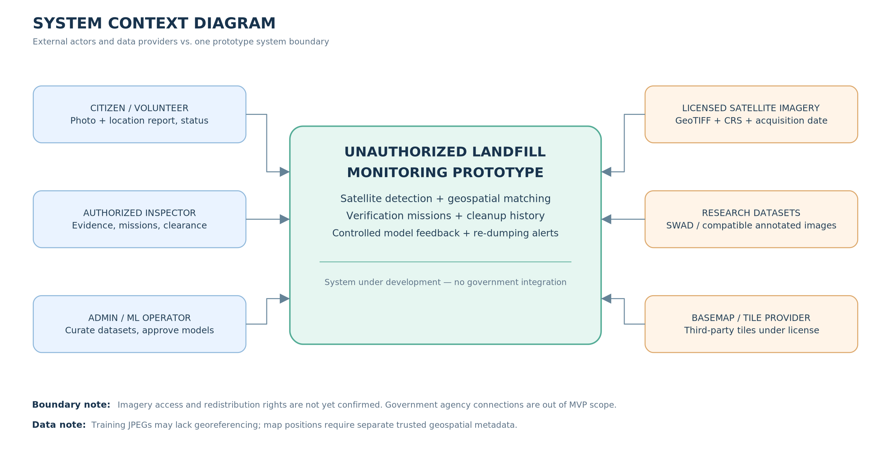
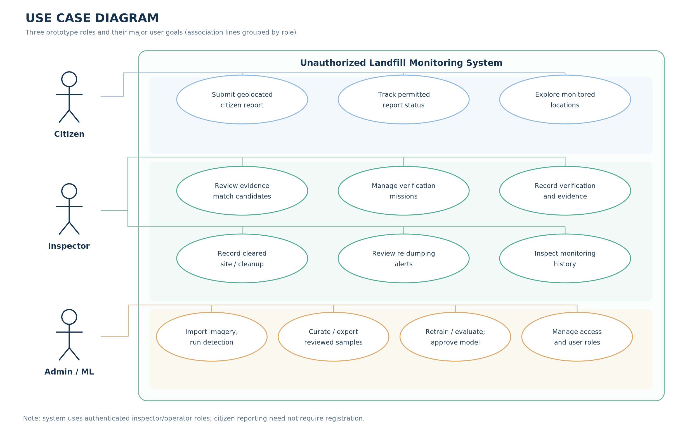
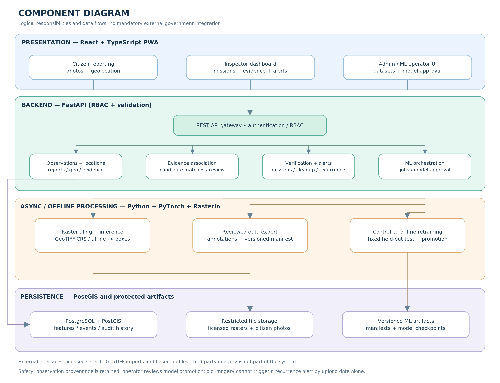

# 7. Architecture & Diagrams

**Project:** Development of a system for detecting and monitoring the locations of unauthorized landfills based on the analysis of satellite images and crowdsourcing.

**Scope:** Balanced MVP v2.0 architecture.

## 7.1. Architectural Approach

The proposed system will follow a modular, layered architecture. A mobile-first Progressive Web Application (PWA) will serve citizens, inspectors, and technical administrators through role-appropriate interfaces. A FastAPI backend will implement authorization, geographic evidence management, verification tasks, monitoring history, re-dumping rules, and model-related operations. PostgreSQL with PostGIS will store structured records and geometry, while a restricted file store will hold satellite imagery, citizen photographs, exported datasets, and model artifacts. Image processing, object detection, and training will run as separate Python jobs rather than long-running HTTP requests.

This modular architecture is preferred over a microservices-based deployment to reduce operational complexity for a single-developer diploma project, while preserving clear component responsibilities and testable interfaces. The components and data flows are defined below.

## 7.2. System Context Diagram

**Figure 7.1. System context for the proposed landfill monitoring prototype.**

Three external roles interact with the system: (1) a citizen or volunteer who submits geolocated environmental reports and views permitted statuses; (2) an authorized inspector who reviews predictions, manages verification missions, records cleanup, and responds to possible re-dumping; and (3) an administrator/ML operator who imports imagery, curates approved satellite training data, manages accounts, and evaluates model versions. Inspector and administrator functions require authenticated access.

The system also depends on external satellite imagery providers, research datasets, and a licensed basemap/tile provider. Access to suitable KazEOSat/Airbus imagery is subject to provider approval and licensing. Research datasets support model development but do not necessarily supply trusted geographic coordinates for a real-world map. Government database integration is outside the mandatory MVP.

## 7.3. Use Case Diagram

**Figure 7.2. Major use cases, grouped by prototype user role.**

**Citizen:** submit a photo and geographic coordinates; adjust the selected map location; obtain a submission reference and view permitted status information; explore public/authorized map information.

**Inspector:** review suggested evidence matches; create and manage verification missions; attach field observations; confirm waste presence, reject a false positive, or mark a result inconclusive; record a confirmed cleanup; inspect a site's history; review and resolve re-dumping alerts.

**Administrator/ML operator:** import licensed georeferenced satellite imagery; initiate detection jobs; review properly annotated satellite samples; export dataset versions; conduct offline retraining and baseline comparisons; explicitly approve an active model version; manage user roles and access.

Use cases are organized by the intended user role. Public reporting may be available without mandatory account registration; inspector and administrator actions require authentication and role-based authorization.

## 7.4. Component Diagram

**Figure 7.3. Proposed layered component architecture.**

| Layer | Components | Responsibility |
|---|---|---|
| Presentation | React + TypeScript PWA, Leaflet | Mobile reporting, inspector dashboard, model/admin operations, maps |
| API / domain | FastAPI, authentication and role checks | Validate requests and enforce authorized workflows |
| Domain: monitoring | Location/Observation Service | Preserve independent satellite and citizen observations linked to a monitored location |
| Domain: fusion | Evidence Association Service | Suggest proximity- and time-informed candidate matches; retain human review decisions |
| Domain: verification | Mission and Cleanup Service | Maintain mission statuses, evidence, verification results and cleanup history |
| Domain: recurrence | Re-Dumping Rules | Create idempotent reinspection alerts only from temporally qualifying new observations |
| ML orchestration | Imagery/ML Jobs and Model Approval | Track asynchronous processing and explicit model version selection |
| Background jobs | Rasterio + PyTorch inference | Tile GeoTIFF, retain transforms, predict boxes and map them to geographic coordinates |
| Offline ML workflow | Data review, dataset export, training/evaluation | Validate satellite annotations; export versioned manifests; compare candidate models on independent data |
| Persistence | PostgreSQL/PostGIS | Geometry, observations, mission state, event history, access metadata, model metadata |
| Protected artifacts | File storage / model directory | Licensed GeoTIFF, citizen photos, dataset manifests, model checkpoints |

The component diagram shows a logical decomposition; it does not mandate separate deployed services or a distributed task queue for the MVP. An initial implementation can use a local job runner with persisted task state, provided ordinary API requests are not blocked by training or large raster inference.

## 7.5. Principal Data Entities and Relationships

The initial conceptual data model contains the following entities:

- **MonitoredLocation**: site identifier, geographic point/footprint, current review state and references to observations.
- **SatelliteImage**: licensed source, file reference, sensor/resolution if known, acquisition timestamp if known, CRS, affine transform, and image footprint.
- **Detection**: source image and tile, bounding box, class, confidence, model version, and derived map geometry only if trusted spatial metadata exist.
- **CitizenReport**: photograph reference, submitted location, user-provided observed timestamp if available, received timestamp, description, and public status token/reference.
- **Observation**: source type, source record, observation time and its certainty, geographic position/accuracy, and provenance. A location can have multiple observations.
- **EvidenceMatch**: two observations or observation/site links, matching explanation, review status, decision author and timestamp. Candidate matches do not erase source records.
- **VerificationMission**: associated location, reason, priority explanation, status, assigned reviewer if applicable, evidence and outcome.
- **CleanupEvent**: location, effective cleanup date, decision actor, evidence/justification and immutable audit history.
- **ReDumpingAlert**: location, triggering observation, referenced cleanup event, alert status, explanation and deduplication key.
- **TrainingCandidate / DatasetVersion / ModelVersion**: source satellite samples, annotation and approval status, dataset manifest and split, model configuration, evaluation metrics and explicit activation state.

Protected images and raster files will be referenced by metadata records rather than directly embedded as large binary blobs in every database row. Sensitive citizen information and original uploads will not be exposed by unrestricted public API endpoints.

## 7.6. Critical Data Flows and Architectural Rules

**A. Satellite detection and georeferencing.** An authorized operator uploads a permitted GeoTIFF. The processing component validates image metadata, builds tiles while retaining each tile's affine transformation and coordinate reference system, executes object detection, and transforms detected coordinates into the required map CRS. Predictions are stored as *potential* dumping locations with a source image and model version. When georeferencing is missing or unreliable, the predictions remain image-based and are not assigned fabricated geographic coordinates.

**B. Citizen evidence and verification.** A citizen submits an image and a manually selected or device-derived geographic location. The system stores the original report separately from satellite predictions. A geographic rule proposes potentially related observations; an inspector accepts, rejects or defers ambiguous associations. Verification missions retain their evidence, reviewer decision, and timestamps. A negative inspection result is recorded rather than silently deleting an earlier ML detection.

**C. Re-dumping alerts.** A location has a confirmed cleanup event with an effective timestamp. When a subsequent observation is associated with that location, the recurrence rule evaluates the *observation/acquisition time*, not merely the upload time. A new temporally valid observation can create an alert requesting human review. An old image uploaded today must not automatically cause a recurrence alert. Observations with unknown dates or uncertain spatial associations are referred for review. An idempotent key prevents repeated processing of the same observation from creating duplicate active alerts. Legal confirmation of unauthorized dumping remains a human responsibility.

**D. Controlled model improvement.** A verified site or report may motivate review of a corresponding *satellite image crop*. Only a properly licensed satellite image with valid, human-reviewed object annotations becomes a training candidate; a citizen's ground photograph is not treated as a satellite training image. Approved examples are exported with dataset and annotation manifests. Retraining is an explicit offline operation. New and baseline models are compared with documented settings and a protected independent test set; no automatic model promotion occurs. The confirmed scene overlap in SWAD v2 must be addressed before independent evaluation.

## 7.7. Architectural Constraints and Consistency

**Security and privacy.** Authenticated actions are authorized at the API, not only hidden in the user interface. File uploads are validated. Raster and report files reside in access-controlled storage. Critical reviewer actions and active-model changes are recorded with actors and timestamps.

**Temporal integrity.** Acquisition time, citizen observation time, submission time and cleanup effective time are separate fields. Unknown timestamps must not be silently substituted with submission time for re-dumping decisions.

**Spatial integrity.** Source CRS, geographic transforms and accuracy are preserved when available. Spatial proximity creates a candidate evidence match rather than an irreversible automatic merge.

**Data access and licensing.** External map tiles and satellite imagery are used subject to service terms. Access requests to imagery providers have been submitted, but the availability and academic license are not confirmed. The pilot area is selected only after suitable imagery is available.

**Verification.** Component tests, API tests and quantitative ML evaluation are defined in Section 9.

**Requirements traceability.** Satellite inference and geographic accuracy support FR-01–FR-05 and NFR-04; citizen interfaces and maps support FR-06–FR-10; geospatial matching supports FR-11–FR-14; verification supports FR-15–FR-18; cleanup and alerts support FR-19–FR-22; controlled retraining supports FR-23–FR-27; and authenticated access/audit support FR-28–FR-30 and NFR-05–NFR-10. The implementation must preserve the acceptance criteria approved in Section 6.
