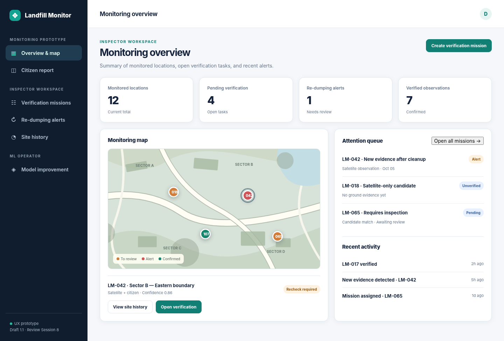
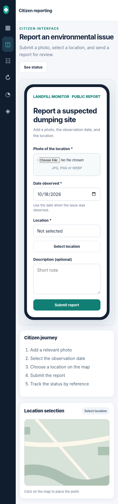
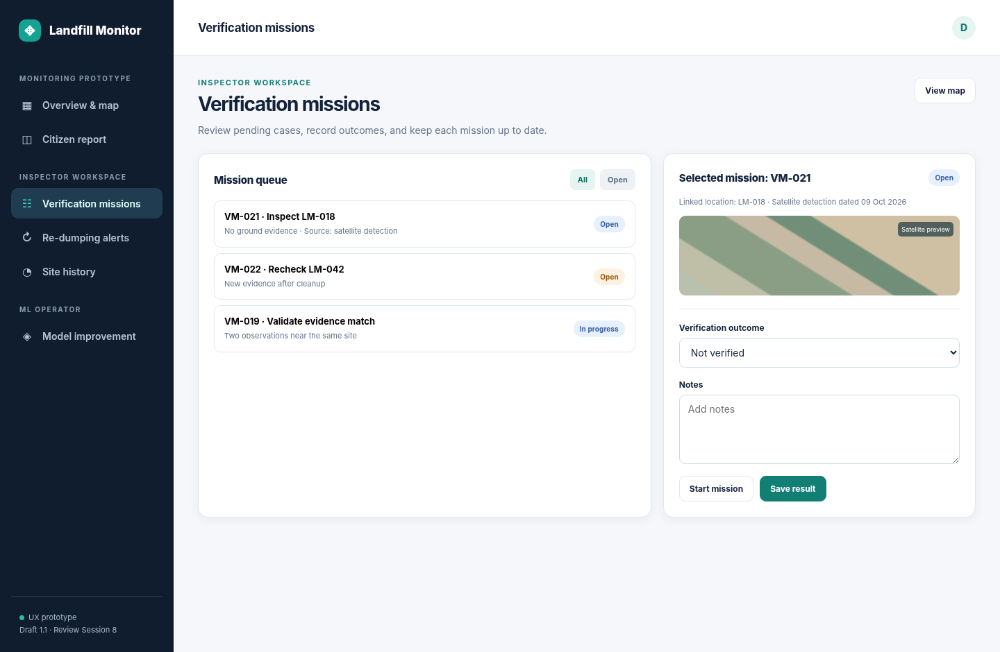
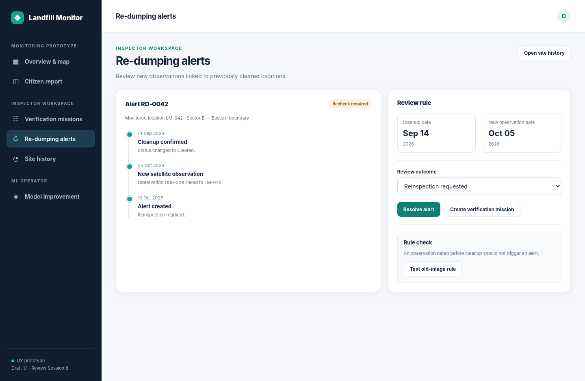
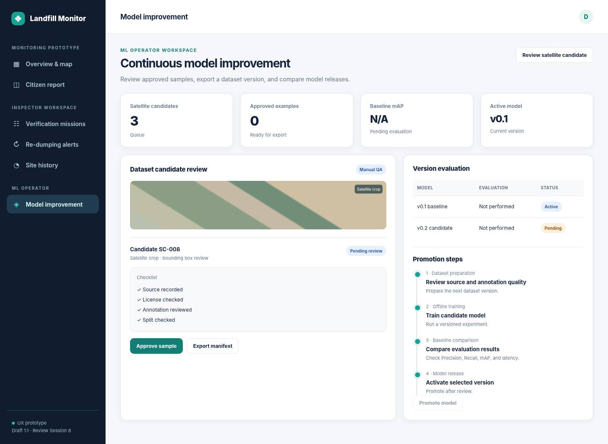

# 8. UX / Prototype

**Project:** Development of a system for detecting and monitoring the locations of unauthorized landfills based on the analysis of satellite images and crowdsourcing.

**Status:** UX prototype v1.1 for Balanced MVP v2.0. It uses local interactions and example records.

## 8.1. UX Goals and User Roles

The prototype demonstrates how the proposed system supports three different groups without conflating their permissions or technical responsibilities: (1) a **Citizen** submitting a georeferenced environmental observation from a phone; (2) an **Inspector** reviewing potential dumping sites, managing verification missions, recording cleanup, and checking potential recurrence; and (3) an **Administrator/ML Operator** managing approved satellite training candidates and model versions.

The main UX objectives are to minimize friction for reporting environmental concerns; distinguish model predictions from verified facts; make geographical and temporal evidence traceable; support clear reviewer decisions; and keep the model improvement process controlled and auditable. The citizen interface is mobile-first, while inspector and ML-operator workflows are desktop-oriented but responsive.

## 8.2. Navigation and Screen Inventory

The interactive HTML prototype includes the following screens:

| Screen | Intended user | Primary purpose | Requirements |
|---|---|---|---|
| P-01. Monitoring Overview | Inspector | Inspect map markers, status summaries, and attention queue | FR-09–FR-10, FR-11, FR-16 |
| P-02. Citizen Report | Citizen | Add a photo, observation date, geographic point, and optional description | FR-06–FR-08 |
| P-03. Verification Missions | Inspector | Review why a location needs a field check and record a human outcome | FR-15–FR-18 |
| P-04. Re-Dumping Alerts | Inspector | Compare a recorded cleanup with later observations and resolve a reinspection alert | FR-19–FR-22 |
| P-05. Site Monitoring History | Inspector | Examine independent source observations and ordered decisions for one location | FR-11, FR-14, FR-19–FR-22 |
| P-06. Model Improvement | Administrator / ML Operator | Review satellite training candidates, prepare dataset manifests, and inspect model evaluation gates | FR-23–FR-27 |
| P-07. Public Status Lookup | Citizen | Access limited status details using a report reference | FR-08, FR-28 |

**Figure 8.1. Monitoring Overview** — `../prototype/screenshots/01_inspector_overview.png`

**Figure 8.2. Mobile Citizen Reporting** — `../prototype/screenshots/07_mobile_citizen.png`

**Figure 8.3. Verification Missions** — `../prototype/screenshots/03_verification_missions.png`

**Figure 8.4. Re-Dumping Alerts** — `../prototype/screenshots/04_re_dumping_alerts.png`

**Figure 8.5. Model Improvement** — `../prototype/screenshots/06_model_improvement.png`

The Site Monitoring History and Public Status screens are accessible inside the prototype; a separate Site History screenshot is also included in the deliverable.

## 8.3. Key User Scenarios and Interaction Flows

### Scenario UX-01 — Citizen Submits a Georeferenced Report

**Actor:** Citizen. **Entry point:** mobile web application.

1. The citizen opens **Report an environmental issue** without mandatory registration.
2. The application requests a photograph, date of observation, and location. A description is optional.
3. The citizen chooses a map location or manually corrects a proposed device-derived location; declining GPS access must not block reporting.
4. The form validates the required data and displays a confirmation reference.
5. The citizen may check an appropriately limited public status using the reference.

**Expected result:** A citizen observation is recorded for inspection and kept separate from satellite training data.

**UX acceptance checks:** Missing photos and locations receive comprehensible validation; date is explicitly labeled as observation date; the interface remains usable on a narrow mobile viewport; inspector-only details cannot be retrieved through the public interface.

### Scenario UX-02 — Inspector Reviews a Satellite Detection

**Actor:** Inspector. **Entry point:** Monitoring Overview.

1. An inspector opens a map containing potential dumping locations and their current review states.
2. Selecting a marker displays the monitored location reference, evidence types, and verification state.
3. If a detection has insufficient corroboration or conflicting evidence, the attention queue explains the review reason.
4. The inspector opens a Verification Mission and records **Waste present**, **False positive / no waste found**, or **Inconclusive**, with comments and supporting evidence.
5. The decision is preserved as an event and does not erase the initial model prediction.

**Designed result:** A traceable human verification outcome is linked to a specific observation and monitored location. The software does not make a legal finding that disposal was unauthorized.

**UX acceptance checks:** Reasons are visible; the mission cannot be completed without an outcome; decisions are reviewer-authorized; original evidence remains traceable.

### Scenario UX-03 — Possible Re-Dumping After Cleanup

**Actor:** Inspector. **Entry point:** Re-Dumping Alerts or a site history.

1. A monitored location has a confirmed cleanup event with an effective date.
2. A later satellite detection or citizen observation is tentatively associated with that location.
3. A rule compares the **observation/acquisition date** to the cleanup date, not the upload or processing date.
4. A qualifying observation raises a **Recheck required** alert; the inspector sees both the earlier cleanup record and new evidence.
5. The inspector creates a reinspection mission, requests more evidence, or dismisses the alert after review.

**Expected result:** An alert is attached to the site's history for a repeat inspection.

**Negative UX test:** An older image acquired before cleanup but uploaded afterwards must not generate an automatic re-dumping alert. Ambiguous dates and locations require review.

### Scenario UX-04 — Controlled Model Improvement

**Actor:** Administrator / ML Operator. **Entry point:** Model Improvement.

1. A human-reviewed monitoring event identifies a potentially useful **satellite image crop**.
2. The operator reviews the imagery source, rights, annotation, and separation from independent test scenes.
3. An approved candidate can be included in an exported versioned dataset manifest.
4. Training and model evaluation are carried out **offline**; a candidate is compared with a recorded baseline on an independent test set.
5. Deployment/activation requires explicit authorization after evaluation.

**Expected result:** A reviewed satellite dataset version and recorded model evaluation workflow.

**UX acceptance checks:** Unreviewed candidates cannot be treated as approved; the model promotion button is disabled in the conceptual prototype; metrics are marked *Not performed* rather than fabricated; source-scene overlap in SWAD v2 must be addressed before any independent test claim.

### Scenario UX-05 — Inspector Examines Monitoring History

**Actor:** Inspector. **Entry point:** Monitoring Overview or Re-Dumping Alert.

1. The inspector opens a monitored location.
2. The timeline shows satellite observations, citizen reports, verification decisions, cleanup records and alerts as separate dated events.
3. Each event provides its type, source reference, available observation/acquisition date and human decision where relevant.
4. An inspector can trace the evidence that triggered a review or a possible recurrence.

**Expected result:** An ordered site history with links to individual observations and review decisions.

## 8.4. UX Principles and Interaction Decisions

**Source distinction.** The interface distinguishes satellite detections, citizen reports, review decisions, and cleanup events. A satellite confidence score is a model output, not the probability that illegal dumping is legally established.

**Temporal clarity.** Observation/acquisition dates and submission/processing dates must not be mixed. Re-dumping alerts indicate *possible recurrence* until human confirmation.

**Explainable actions.** A verification queue displays why a location requires review (missing ground evidence, an unresolved matching proposal, or new evidence after cleanup). A prioritization label must not be presented as a scientifically validated environmental hazard ranking.

**Privacy and access.** Citizens see an appropriate public receipt and permitted status. Inspector notes, internal evidence, private contact data, and model-administration controls remain restricted. Validation and role enforcement must occur on the backend in the future implementation, not merely through hidden frontend controls.

**Mobile-first input.** Photo selection, labels, touch targets, date input, location correction, and form validation are arranged for a narrow phone viewport. The mockup uses a schematic map; a production system must obtain lawful map tiles and georeferenced imagery.

**Reproducibility.** Training candidates, dataset versions, and model versions are visibly separate. Model metrics are displayed only after an experiment is recorded.

## 8.5. Prototype Scope and Implementation Status

The deliverable is a self-contained, clickable HTML/CSS/JavaScript prototype that can be opened locally in a modern browser. It includes role-oriented navigation, map markers over a **schematic non-geographic illustration**, sample observation histories, a citizen form, mission status changes, a recurrence review, a simulated training-candidate approval state, and an illustrative JSON-manifest download.

All interactions use local browser state. The maps, records and model figures are sample data. Backend integration, persistent storage, geospatial processing and ML inference are planned for later stages.

The prototype provides a reference for implementation and later functional acceptance tests.

## 8.6. UX Validation Plan

The following checks will be conducted during later implementation and acceptance testing:

| UX Check | Evaluation method | Acceptance focus |
|---|---|---|
| Mobile reporting | Walkthrough at 360 px viewport and manual validation tests | Required fields understandable; no mandatory horizontal scrolling |
| Location permission denial | Simulate denied geolocation permission | Manual location selection remains possible |
| Source and status clarity | Scenario inspection with representative records | Users distinguish prediction, report, verification, cleanup, and alert |
| Mission completion | Positive and negative workflow tests | Explicit reviewer outcome and preserved evidence |
| Re-dumping temporal rule | Date-order boundary cases | Older acquisition date does not create a false recurrence alert |
| Model improvement safeguard | Attempt approval and promotion without QA/evaluation | Unreviewed data not exported; model not auto-activated |
| Access permissions | API-level authorization tests during implementation | Citizen cannot access restricted inspector/ML actions |

The screens are based on the proposed requirements and comparisons with existing systems. Usability should be assessed with target users when participants are available.

## 8.7. Conclusion

The UX prototype translates the approved system requirements into coherent citizen, inspector, and ML-operator interaction flows. Its main emphasis is not merely the presence of a reporting form or a map, since established systems already provide those capabilities. The intended engineering value is the traceable progression from satellite detection and citizen observation to verification, monitored cleanup, possible recurrence, and controlled improvement of the detection model.

The next stage will connect the selected interfaces to the backend and test the workflows with real or appropriately prepared records.
